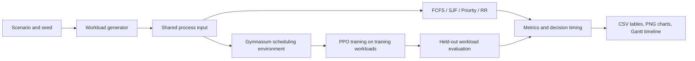

# Adaptive CPU Scheduling Simulator

This project evaluates whether a PPO policy that selects a ready process can improve selected scheduling metrics enough to justify its decision cost. It is a discrete-event simulator, not an operating-system kernel scheduler. The baseline algorithms work independently of PPO; PPO uses Gymnasium and Stable-Baselines3.

## Architecture



## Modules

- `models.py`: process records, execution segments, and schedule results.
- `workloads.py`: five seeded synthetic workload generators and CSV I/O.
- `algorithms.py`: FCFS, non-preemptive SJF, non-preemptive priority, and preemptive Round Robin.
- `metrics.py`: independent metric calculations and timing fields.
- `environment.py`: fixed-shape Gymnasium state/action interface, queue advancement, valid action indices, and reward.
- `ppo.py`: Stable-Baselines3 PPO training/checkpoints and deterministic evaluation.
- `experiments.py`: identical inputs for each algorithm, raw/aggregate records, metadata, and per-process outputs.
- `visualization.py`: PNG comparison plots, training reward curve, and Gantt charts.
- `cli.py`: command-line entry points.

## Install

Use Python 3.10 or newer. A virtual environment is recommended.

```powershell
py -3.12 -m venv .venv
.\.venv\Scripts\Activate.ps1
python -m pip install --upgrade pip
python -m pip install -e ".[test]"
```

The project declares NumPy, pandas, Matplotlib, Gymnasium, Stable-Baselines3, and pytest. PPO depends on a CPU-compatible PyTorch wheel installed through Stable-Baselines3. The baseline modules do not import PPO or require PyTorch when used on their own.

## Quick demonstration

From this folder:

```powershell
cpu-scheduler demo --output-dir results/demo --n 10 --seed 7 --quantum 3
```

Or without installing the console entry point:

```powershell
$env:PYTHONPATH = "src"
python -m adaptive_scheduler.cli demo --output-dir results/demo --n 10 --seed 7
```

The demo writes a workload, per-run and aggregate CSVs, per-process timelines, baseline Gantt PNGs, and metric comparison PNGs. It is a functional smoke workflow; it does not train PPO and is not experimental evidence about learned-policy quality.

## Commands

```powershell
# Generate and inspect a workload
cpu-scheduler generate --n 30 --scenario mixed --seed 12 --output results/workload.csv

# Run a classical baseline (priority 0 is highest priority)
cpu-scheduler baseline --algorithm fcfs --scenario mixed --seed 12 --output-dir results/fcfs
cpu-scheduler baseline --algorithm sjf --n 20 --scenario uniform
cpu-scheduler baseline --algorithm priority --n 20 --scenario priority
cpu-scheduler baseline --algorithm rr --quantum 4 --n 20 --scenario bursty

# PPO quick functionality check (short training does not establish policy quality)
cpu-scheduler train --n 30 --scenario mixed --seed 11 --timesteps 50000 --model results/models/experiment_ppo

# Validate on a separate seed set before final test
cpu-scheduler compare --split validation --scenarios uniform priority --seeds 31 42 53 --n 30 --quantum 3 --model results/models/experiment_ppo --output-dir results/validation

# Freeze the model/configuration, then run the final held-out comparison
cpu-scheduler compare --split test --scenarios uniform mixed bursty priority cpu_intensive --seeds 101 202 303 --n 30 --quantum 3 --model results/models/experiment_ppo --output-dir results/experiments

# Evaluate one saved policy on one workload with a Gantt chart
cpu-scheduler evaluate --model results/models/experiment_ppo --n 30 --scenario bursty --seed 101 --output-dir results/evaluation
```

`configs/demo.json` and `configs/experiment.json` record suggested reproducible settings. The CLI writes the settings actually used, package versions, seeds, timing method, and switch-count convention to `run_metadata.json` in each output directory. CSV workload files are reused exactly across all algorithms within each scenario/seed run. If a scheduler fails, its row remains in `per_run_results.csv` with a failure status and error.

## Methodology and definitions

The workload scenarios vary burst and arrival distributions, including clustered arrivals and short/long mixtures. Seeds make workloads reproducible. Training workload generation is performed inside the PPO environment; save its scenario/seed and settings with the model. Use validation seeds for any configuration selection, then freeze the configuration and use distinct final-test seeds once for the reported result. `compare --split validation` and `compare --split test` write separate metadata and raw result files. All algorithms receive the same generated process list within each split/scenario/seed.

For custom workload distributions, call `generate_workload` with distribution dictionaries. Supported kinds are `uniform`, `normal`, `poisson`, `categorical`, and `fixed`; for example `generate_workload(50, "mixed", 9, arrival_distribution={"kind": "poisson", "lam": 8}, burst_distribution={"kind": "uniform", "low": 1, "high": 30}, priority_distribution={"kind": "categorical", "values": [0, 1, 2], "probabilities": [0.2, 0.3, 0.5]}, short_job_fraction=0.65)`. Scenario defaults define visibly different workloads when overrides are not supplied.

FCFS uses earliest arrival, with input order resolving ties. SJF chooses the shortest available CPU burst and is non-preemptive. Priority scheduling is non-preemptive; lower integer values mean higher priority. It has no ageing and can starve lower-priority work. Round Robin is preemptive, configurable by time quantum, and admits arrivals during a slice before re-queuing an unfinished process.

The PPO environment uses a fixed vector with five normalized values per workload slot (ready flag, remaining burst, elapsed waiting, priority, and time since arrival), plus global time and queue length. Action `i` refers to input slot `i`; only ready slots are valid. Since ordinary SB3 PPO does not mask categorical actions, a padded/unready selection is explicitly flagged, penalized, and safely replaced by the first valid slot without corrupting process state. When no process is ready, simulation time advances to the next arrival before observation. A policy action dispatches one process to completion (non-preemptive process selection); compare this limitation with preemptive RR.

Reward is the negative integral of ready-queue waiting time accumulated during a dispatch, divided by `max(1, process_count × maximum_burst)`, less `0.02` per switch and `0.1` for an invalid action. This approximates total waiting cost without adding turnaround as a second version of the same delay. Standard evaluation metrics are calculated separately from reward. Reward weights are constructor settings in `SchedulingEnv` and can be varied for ablations.

Waiting time is turnaround minus burst; turnaround is completion minus arrival; response is first start minus arrival. Throughput is completed processes divided by simulation elapsed time from time zero. CPU utilization is busy simulated time divided by elapsed time. Context switches count transitions between different process IDs on contiguous timeline segments; initial dispatch and idle-to-process transitions are excluded. Decision overhead is measured using `time.perf_counter_ns` around the decision selection/policy inference only. It excludes simulated CPU time and is a noisy wall-clock measurement; use repetitions and report mean and standard deviation rather than treating one run as definitive.

## Outputs

- `workloads/*.csv` and sidecar JSON: identical seeded process inputs.
- `per_run_results.csv`: raw metrics and failed-run status.
- `aggregate_results.csv`: per-scenario mean and standard deviation.
- `overall_summary.csv`: overall mean and standard deviation across successful per-run records.
- `process_results/*.csv`: per-process timestamps and derived metrics.
- `charts/*.png`: waiting, turnaround, response, throughput, switches, decision overhead, and utilization comparisons.
- `*_gantt.png`: execution timeline visual for explaining dispatch decisions.
- PPO checkpoint `.zip`, `.rewards.csv`, and reward PNG from training.

## Validation and current limits

Run automated checks with:

```powershell
python -m pytest
```

The simulator assumes a single CPU, one CPU burst per process, no I/O blocking, and zero modeled dispatch duration. PPO actions are non-preemptive and the standard PPO policy does not use an action mask; invalid actions are exposed and penalized. A checkpoint's observation/action dimensions are fixed to its training process count, so evaluate it with the same process count. Synthetic workloads are not traces of real systems. A short demonstration training run checks integration only. Claims about learning effectiveness require longer documented training, separate validation and final test sets, repeated seeds, comparison of all scenarios, and analysis of decision overhead. The report's broader peer-reviewed literature review remains outside this executable simulator.

## Implementation progress for review

Working code in this package covers workload generation/export, all four classical policies, shared metric calculation, a timeline and Gantt output, a Gymnasium environment, PPO training/evaluation, experiment aggregation, and comparison visualizations. Automated test results and actual PPO/held-out execution status must be reported from the run performed; this README does not claim empirical gains.

## Verified run in the supplied workspace

The implementation was exercised with Python 3.12.14, NumPy 2.5.4, pandas 3.0.1, Matplotlib 3.11.2, Gymnasium 1.4.0, Stable-Baselines3 2.9.0, and CPU PyTorch 2.14.1. The automated suite completed with 16 passing tests, including baseline hand whcalculations, RR arrivals/quantum boundaries, metric invariants, Gymnasium API validation, CSV round-tripping, identical comparison inputs, experiment exports, switch-count edge cases, and PPO checkpoint save/load.

The compact demonstration generated baseline tables and Gantt charts. A PPO policy was trained for 1,024 requested timesteps on 12-process mixed workloads, saved, and reloaded. A separate validation run used uniform and priority workloads at seeds 31 and 42 (20 successful records); the final test run used all five categories at seeds 101 and 202 (50 successful records). This short training run verifies the workflow; it is not sufficient evidence that PPO has learned an effective policy. Across this quick final test, average waiting time was 70.69 for PPO, 56.56 for non-preemptive SJF, 71.83 for Priority, 75.53 for FCFS, and 107.36 for RR. PPO therefore did not outperform SJF in this run. The mean measured PPO decision overhead was about 4.8 milliseconds per workload evaluation; this is a small, noisy measurement and should not be treated as a stable hardware benchmark. Inspect the saved per-scenario results before drawing any conclusion.
